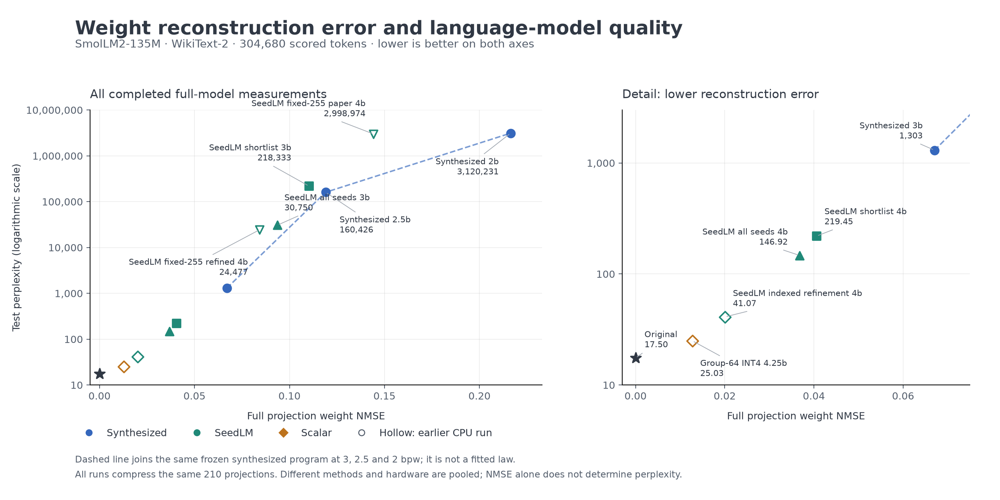

# SmolLM2 laptop evaluations

Completed on 26 November 2026 using an RTX 3050 Laptop GPU for perplexity and CPU encoders. These runs use the same pinned checkpoint, tokenizer, WikiText-2 files, FP32 inference, nonoverlapping 1,024-token contexts and 304,680 scored targets as the earlier experiments. Batch size is one. All 210 attention and MLP projection matrices are compressed; embeddings and normalizations retain their original precision. Rates refer to projection payloads, not the full model.

| Method | Projection bpw | Full projection NMSE | Perplexity |
| --- | ---: | ---: | ---: |
| Original | 16 | 0 | 17.4952 |
| Synthesized | 2 | 0.216360 | 3,120,230.99 |
| Synthesized | 2.5 | 0.119031 | 160,426.40 |
| Synthesized | 3 | 0.067048 | 1,302.79 |
| SeedLM, 1,024-seed shortlist | 3 | 0.110293 | 218,332.56 |
| SeedLM, all seeds | 3 | 0.093659 | 30,749.52 |
| SeedLM, 1,024-seed shortlist | 4 | 0.040587 | 219.45 |
| SeedLM, all seeds | 4 | 0.036790 | 146.92 |

All synthesized runs use frozen program `3-9796`; increasing bitrate expands its seed domain rather than searching for a new program. At 3 bpw, a 20-bit seed and 4-bit exponent describe eight weights. The separate-scale index matches exhaustive search and the independent scalar decoder on the eight audited blocks recorded in `synthesized_3/encoder_audit.json`. Encoding took 4,789 seconds and evaluation took 127 seconds. SeedLM runs here use the published coefficient rule; they do not use the earlier coefficient-refinement encoder, which reached 41.07 perplexity at 4 bpw.

Each method directory contains the raw perplexity row, sampled activation errors and run configuration, including source hashes. The local CUDA environment used PyTorch 2.14.1+cu130 instead of the locked CPU build; `environment.txt` records the installed versions. Native Windows SeedLM encoding used the existing C++ source, MinGW and SciPy's bundled OpenBLAS. Absolute paths in configurations identify the original local inputs.



The plot combines these eight runs with four earlier CPU measurements, excluding smoke tests and duplicate baselines. It joins only the three synthesized rates; the line is not a fitted model. Plot data retain source paths. The apparent log-linear trends are exploratory and do not establish a universal mapping from NMSE to perplexity. A 3.5-bpw full-model evaluation has not been performed.

Regenerate the plot from the repository root:

```sh
uv run --locked python -m experiments.evaluation.plot_model_quality \
  --runs experiments/results/laptop-rtx3050 \
  --out experiments/results/laptop-rtx3050/plots
```

An exploratory fused CUDA exhaustive-search prototype matched the CPU encoder on 128 blocks but was slower: 0.200 seconds versus 0.124 seconds. `synthesized_3/gpu_benchmark.json` preserves that small benchmark; it is not a full-run GPU timing or evidence that an optimized GPU index would be slower.
